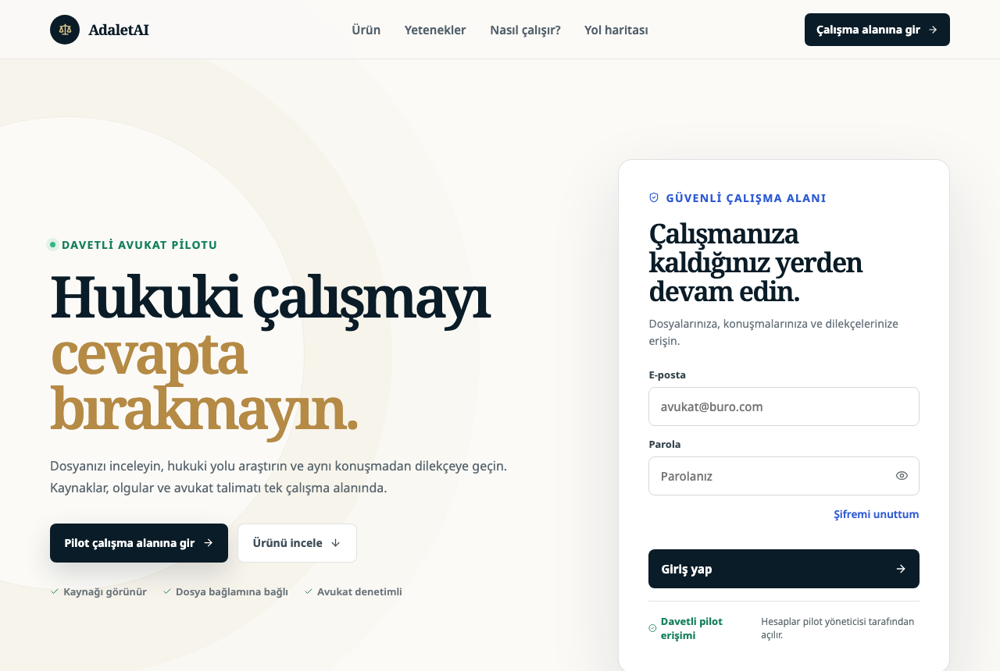
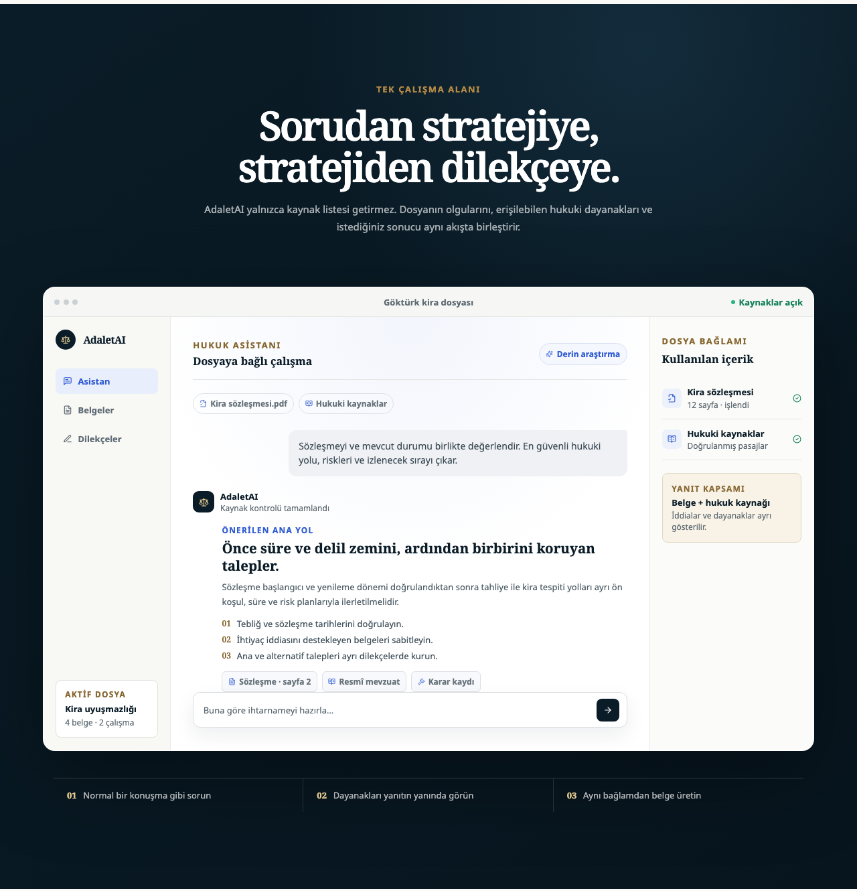

# AdaletAI

A legal-work assistant for Turkish lawyers. A lawyer uploads the documents of a matter, asks questions in plain language, gets answers that cite the document page or the legal source they rest on, and turns the same conversation into a draft petition or notice to review.

*Adalet* means "justice" in Turkish.

**This repository is an overview.** AdaletAI is my own project and the source code is private. This page describes what is built, how it is built and what it does not do yet. The pilot runs at [adaletai-beta.vercel.app](https://adaletai-beta.vercel.app/login) and is invite-only.

## What it does

*From the public landing page. The matter shown is an invented example.*

- **Matter workspace.** Each matter has its own documents, conversations and drafts. Firms and their members are separated at the database level.
- **Document intake.** PDF, DOCX, scanned PDF, images and UDF (the file format of the Turkish court system) are read, split into source units and indexed.
- **Cited answers.** A long-running chat answers from the matter's documents and from legal sources. Every claim points to the exact passage it came from. Document claims and legal claims are shown apart.
- **From answer to draft.** The same conversation can produce a matter brief, a formal notice, or a civil claim or response petition for a lawyer to review and export to Word or PDF.
- **Legal research.** A first owned corpus covers rental law, with a fallback to official sources. It is a test of the approach, not national coverage.
- **Feedback and evaluation.** The app records feedback on answers and drafts. That feedback and a set of fixed evaluation suites are how quality is measured.

## How it is built

| Part | What I used |
| --- | --- |
| Web app | Next.js 16, React 19, TypeScript |
| Data, auth, storage | Supabase (Postgres) with row-level security on every tenant table |
| Retrieval | Hybrid search: Postgres full-text search plus vector embeddings |
| Background work | A separate worker service for document processing |
| Browser extension | A Chrome extension for pairing with the court portal, built against fixtures |
| Tests | Vitest and Playwright |
| Delivery | GitHub Actions and Vercel |

The codebase is a pnpm monorepo: one web app, one extension, one worker and six shared packages (AI, database, contracts, legal research, file storage, observability).

Some numbers from the repository as of August 2026:

- 340 commits, starting 14 July 2026
- 443 TypeScript files
- 164 test files
- 70 database migrations
- 34 architecture decision records

## The parts I care most about

**Tenant isolation is tested as an attack.** Row-level security is forced on, and the tests include a hostile second tenant that tries to read the first tenant's matters and documents.

**Answers must show their source.** The model is not allowed to state a legal point without a passage behind it. Citations link to the exact page or source unit.

**Evaluation is part of the build.** There are separate evaluation suites for cited answers, answer quality, work products, petitions, rental-law research and a comparison of retrieval models. Each has a fixed packet of cases and a reference output, so a change can be compared with the last run.

**A person reviews every draft.** Drafts are created for review. Nothing is filed anywhere by the system.

**Decisions are written down.** Each significant design choice has a short decision record, so the reasons survive.

## What it does not do

I keep this list in the private repository too, so the project never claims more than it has.

- It does not have complete or licensed coverage of Turkish case law.
- It does not produce petitions that are ready to file without a lawyer, and it guarantees no legal outcome.
- It has not processed real client files. That waits for separate checks on data processing, storage, retention and security.
- It does not read from, sync with, file to or sign in the live court portal (UYAP). That work exists only against test fixtures.
- It does not carry a model's conclusion from one conversation into the facts of a matter automatically.

## Status

An invite-only pilot. The work was done between July and August 2026. I am the author of all but one of the commits.

## Contact

[mertatalay.com](https://mertatalay.com)
